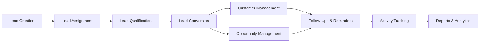

# AcxiomCRM — Enterprise MERN Stack Customer Relationship Management

**AcxiomCRM** is a production-ready, full-stack Customer Relationship Management (CRM) web application engineered using the **MERN Stack** (**M**ongoDB, **E**xpress.js, **R**eact, **N**ode.js). Designed for MCA final project evaluations, campus recruitment submissions, and enterprise hiring assessments, it demonstrates end-to-end software engineering excellence, rigorous multi-tier authorization, database schema design, and seamless customer-to-opportunity sales lifecycle workflows.

---

## 1. Technology Stack Architecture

| Layer | Technology | Version | Purpose |
| :--- | :--- | :--- | :--- |
| **Database** | MongoDB & Mongoose | v8.3 / v8.9.5 | Document database with schema enforcement, compound indexing, and lifecycle hooks |
| **Backend** | Express.js & Node.js | v4.21 / v24.14 | High-performance RESTful API, JWT auth, RBAC scoping middleware, audit trail logging |
| **Frontend** | React SPA (Vite) | v18.3 / v6.0 | Single-page application, React Router 6, component-driven UI architecture |
| **Styling** | Bootstrap 5 & Custom CSS | v5.3.3 | Enterprise SaaS theme: dark navy `#0f172a`, slate `#64748b`, restrained blue `#0284c7` |
| **Data Viz** | Chart.js & react-chartjs-2 | v4.4.7 / v5.3 | Interactive pipeline stage bar charts and lead status distribution charts |
| **Security** | BCrypt, JWT, Helmet, CORS | Latest | Password hashing (salt rounds 10), stateless Bearer tokens, HTTP security headers |

---

## 2. Key Modules & Business Lifecycle



1. **Lead Management**:
   - Captures prospective corporate clients with source, priority, and expected deal value.
   - Status transitions: `New` &rarr; `Contacted` &rarr; `Qualified` &rarr; `Converted` (or `Unqualified`).
   - **Lead Conversion Engine**: Automatically provisions an active `Customer Account` and optionally spawns an initial `Sales Opportunity` deal in one atomic transaction. Once converted, leads are locked to preserve sales pipeline integrity.

2. **Customer Management**:
   - Central repository of active client accounts, auto-generated codes (`CUST-0001`), corporate contacts, and assigned account owners.

3. **Opportunity & Pipeline Management**:
   - Deal tracking across six standard sales stages:
     - `Prospecting` (10%) &rarr; `Qualification` (20%) &rarr; `Proposal` (60%) &rarr; `Negotiation` (80%) &rarr; `ClosedWon` (100%) &rarr; `ClosedLost` (0%).
   - Automatic calculation of **Weighted Pipeline Value** ($\text{Amount} \times \text{Probability}$).
   - Mandatory lost-reason tracking for churned deals.

4. **Follow-Up System**:
   - Scope-filtered task queues: `All`, `Overdue`, `Upcoming`, `Completed`.
   - Global notification bell with live badge count for pending/overdue reminders.
   - Task completion workflow capturing client outcome notes.

5. **Activity Tracking**:
   - Historical audit log of client touchpoints: `Call`, `Meeting`, `Email`, `Task`, `Note` with duration in minutes and meeting minutes.

6. **Executive Reports & Analytics**:
   - Gross vs. Weighted Pipeline valuation.
   - Win/Loss deal conversion percentages.
   - Sales representative productivity leaderboard table.

7. **User & Role Administration (Admin Only)**:
   - Account provisioning with role assignments (`Admin`, `Manager`, `Sales Executive`).
   - Managerial reporting hierarchy configuration.
   - One-click account activation and deactivation.

8. **Security & Business Audit Logs (Admin Only)**:
   - Immutable audit trail recording user identity, action, target entity, timestamp, client IP, and before/after values.

---

## 3. Role-Based Access Control (RBAC) & Scope Matrix

AcxiomCRM implements strict **Server-Side Record Scoping** to protect against **Insecure Direct Object Reference (IDOR)** attacks. Authorization is never delegated solely to UI hiding.

| Resource / Capability | System Admin | Sales Manager | Sales Executive |
| :--- | :---: | :---: | :---: |
| **All Customers Across Org** | Full Access | No | No |
| **Team Customers** | Full Access | Full Access | No |
| **Own Customers** | Full Access | Full Access | Full Access |
| **All Leads Across Org** | Full Access | No | No |
| **Team Leads** | Full Access | Full Access | No |
| **Own Leads** | Full Access | Full Access | Full Access |
| **Pipeline & Opportunities** | Organization Wide | Reporting Team Members | Assigned Deals Only |
| **User & Role Administration**| Full Access | Hidden / Forbidden | Hidden / Forbidden |
| **Security Audit Logs** | Full Access | Hidden / Forbidden | Hidden / Forbidden |
| **Delete Records** | Permitted | Restricted | Forbidden |

---

## 4. Verified Demonstration Credentials

The database automatically seeds standard demonstration accounts upon first startup:

| Role | Email / Username | Password | Access Scope |
| :--- | :--- | :--- | :--- |
| **System Admin** | `admin@acxiomcrm.local` | `Admin@123456!` | Complete administrative control, users, audit logs |
| **Sales Manager** | `manager@acxiomcrm.local` | `Demo@123456!` | Team oversight; sees own records + reporting reps' records |
| **Sales Executive** | `sales1@acxiomcrm.local` | `Demo@123456!` | Individual sales rep; sees only assigned accounts |
| **Sales Executive 2**| `sales2@acxiomcrm.local` | `Demo@123456!` | Peer sales rep (used to test IDOR isolation) |

*(The login screen features **1-Click Quick-Fill buttons** so evaluators and interviewers can test all three roles instantly without typing).*

---

## 5. Project Directory Structure

```text
ACXIOMCRM/
├── server/                                # Express.js & Node.js REST API
│   ├── src/
│   │   ├── config/                        # MongoDB connection & seed data
│   │   │   ├── db.js                      # Auto-starts local MongoDB if needed
│   │   │   └── seedData.js                # Initial users, customers, leads, deals
│   │   ├── controllers/                   # Thin controllers handling requests
│   │   │   ├── authController.js
│   │   │   ├── customerController.js
│   │   │   ├── leadController.js
│   │   │   ├── opportunityController.js
│   │   │   ├── followUpController.js
│   │   │   ├── activityController.js
│   │   │   ├── reportController.js
│   │   │   ├── userController.js
│   │   │   └── auditController.js
│   │   ├── middleware/                    # Security & authorization
│   │   │   ├── auth.js                    # JWT Bearer verification
│   │   │   ├── rbac.js                    # Role permission guard
│   │   │   ├── recordScope.js             # IDOR scope filtering
│   │   │   ├── audit.js                   # Audit log recorder
│   │   │   └── errorHandler.js            # Centralized API error handling
│   │   ├── models/                        # Mongoose schemas & indexes
│   │   │   ├── User.js
│   │   │   ├── Customer.js
│   │   │   ├── Lead.js
│   │   │   ├── Opportunity.js
│   │   │   ├── FollowUp.js
│   │   │   ├── Activity.js
│   │   │   └── AuditLog.js
│   │   └── routes/                        # Express API route declarations
│   ├── .env                               # Server environment variables
│   ├── package.json
│   └── server.js                          # Express entry point & static file server
│
├── client/                                # React 18 Single Page Application
│   ├── src/
│   │   ├── components/                    # Reusable components
│   │   │   ├── Layout.jsx                 # App shell with Sidebar & Topbar
│   │   │   ├── Sidebar.jsx                # Responsive navigation drawer
│   │   │   ├── Topbar.jsx                 # Notification bell & profile menu
│   │   │   └── ProtectedRoute.jsx         # Role-based route guard
│   │   ├── context/
│   │   │   └── AuthContext.jsx            # React Context for auth state & JWT
│   │   ├── pages/                         # Core module pages
│   │   │   ├── Login.jsx                  # Sign in with 1-click demo buttons
│   │   │   ├── Register.jsx               # Self-service sales rep registration
│   │   │   ├── Dashboard.jsx              # Executive KPIs & Chart.js graphs
│   │   │   ├── Customers.jsx              # Customer table & management
│   │   │   ├── Leads.jsx                  # Leads & Conversion modal
│   │   │   ├── Opportunities.jsx          # Pipeline stages & deal forecasting
│   │   │   ├── FollowUps.jsx              # Overdue/upcoming reminder tabs
│   │   │   ├── Activities.jsx             # Calls, meetings, emails log
│   │   │   ├── Reports.jsx                # Leaderboards & win/loss analytics
│   │   │   ├── Users.jsx                  # Admin user provisioning & lockouts
│   │   │   └── AuditLogs.jsx              # System audit trail
│   │   ├── services/
│   │   │   └── api.js                     # Axios instance with JWT interceptor
│   │   ├── App.jsx                        # Route definitions
│   │   ├── App.css                        # Enterprise SaaS design system
│   │   └── main.jsx
│   ├── index.html
│   ├── vite.config.js
│   └── package.json
│
├── data/db/                               # Local MongoDB data directory
├── package.json                           # Root orchestration
├── run.bat                                # Windows 1-click launch batch script
└── run.ps1                                # PowerShell launcher script
```

---

## 6. How to Run the Application

### Option A: 1-Click Launch (Recommended)
Double-click **`run.bat`** in the project root folder.

### Option B: Terminal / Command Prompt
```bash
# 1. Start the server (serves both API & built React frontend)
node server/server.js
```

### Option C: Concurrent Full-Stack Development
```bash
# In one terminal:
npm --prefix server run dev

# In a second terminal:
npm --prefix client run dev
```

Open your browser at: **`http://localhost:5000`** *(or `http://localhost:5173` if running Vite dev server)*.

---

## 7. REST API Endpoint Reference

| Method | Endpoint | Description | Minimum Role |
| :--- | :--- | :--- | :--- |
| `POST` | `/api/auth/login` | Authenticate & retrieve JWT Bearer token | Public |
| `POST` | `/api/auth/register`| Register new sales executive account | Public |
| `GET` | `/api/auth/me` | Fetch authenticated profile details | Sales Executive |
| `GET` | `/api/customers` | Query customers with search, status & scope | Sales Executive |
| `POST` | `/api/customers` | Create new customer account | Sales Executive |
| `PUT` | `/api/customers/:id`| Update customer account (scoped) | Sales Executive |
| `DELETE`| `/api/customers/:id`| Permanently remove customer account | Admin |
| `GET` | `/api/leads` | Query leads with search, source & scope | Sales Executive |
| `POST` | `/api/leads` | Create new sales prospect lead | Sales Executive |
| `POST` | `/api/leads/:id/convert`| **Convert lead to customer & opportunity**| Sales Executive |
| `GET` | `/api/opportunities`| Query sales pipeline and weighted amounts | Sales Executive |
| `POST` | `/api/opportunities`| Open new sales deal | Sales Executive |
| `PUT` | `/api/opportunities/:id`| Progress deal stage or record lost reason | Sales Executive |
| `GET` | `/api/followups` | Retrieve follow-up tasks (All/Overdue/Upcoming)| Sales Executive |
| `POST` | `/api/followups/:id/complete`| Complete task and record outcome notes | Sales Executive |
| `GET` | `/api/activities` | Historical log of calls, meetings & tasks | Sales Executive |
| `POST` | `/api/activities`| Record new client interaction | Sales Executive |
| `GET` | `/api/reports/dashboard`| Dashboard KPIs & Chart.js datasets | Sales Executive |
| `GET` | `/api/reports/analytics`| Win/Loss stats & sales rep leaderboard | Sales Executive |
| `GET` | `/api/users` | List accounts, roles, and reporting managers | Admin |
| `POST` | `/api/users` | Provision new user account | Admin |
| `PATCH`| `/api/users/:id/toggle-status`| Activate or deactivate employee account| Admin |
| `GET` | `/api/audit` | Comprehensive immutable security audit logs | Admin |

---

## 8. MCA Viva Defense & Architecture Q&A

### Q1: Why choose the MERN stack for an enterprise CRM?
**Answer:** The MERN stack offers a unified JavaScript/TypeScript ecosystem across both frontend and backend. 
- **MongoDB** provides a flexible JSON-like document model that mirrors CRM domain models (customer metadata, custom fields, nested activities).
- **Express.js & Node.js** deliver asynchronous, non-blocking I/O ideal for high-throughput REST APIs handling thousands of simultaneous sales interactions.
- **React** powers a responsive, component-driven Single Page Application (SPA) where pages load without full-browser refreshes, improving sales rep productivity.

### Q2: How does the application prevent Insecure Direct Object Reference (IDOR)?
**Answer:** In [recordScope.js](file:///c:/Users/Arun/Desktop/ACXIOMCRM/server/src/middleware/recordScope.js), every database query is filtered based on the authenticated user's token:
- For `Sales Executive`, queries automatically include `{ assignedTo: req.user._id }` or `{ ownerId: req.user._id }`. Even if a user alters the ID in an HTTP request URL (`GET /api/customers/6aec...`), the controller executes `canUserAccessRecord()`, verifying ownership against the database before returning data.
- For `Manager`, the filter dynamically aggregates subordinate IDs via `{ managerId: req.user._id }`.
- For `Admin`, organizational-wide access is authorized.

### Q3: How is password security and authentication managed?
**Answer:** In [User.js](file:///c:/Users/Arun/Desktop/ACXIOMCRM/server/src/models/User.js), passwords are never stored in plaintext. A Mongoose pre-save hook automatically hashes passwords using **BCrypt** with 10 salt rounds. Authentication generates signed **JSON Web Tokens (JWT)** with 24-hour expiration containing the user's ID. Deactivated accounts (`isActive === false`) are blocked at both the login endpoint and the `protect` middleware.

### Q4: How is Lead Conversion handled?
**Answer:** In [leadController.js](file:///c:/Users/Arun/Desktop/ACXIOMCRM/server/src/controllers/leadController.js), the `convertLead` endpoint performs a transactional workflow:
1. Verifies the lead is not already converted.
2. Creates an active `Customer` record inheriting company and contact details.
3. If requested, opens an `Opportunity` deal with title, amount, and close date.
4. Updates the lead status to `Converted`, linking both `convertedToCustomerId` and `convertedOpportunityId`.
5. Records a permanent entry in the `AuditLog` collection.

---

## 9. License & Academic Attribution
Developed for **MCA Final Semester Project Evaluation & Campus Hiring Assessment (2026)**. Built with industry best practices following Layered Monolithic Architecture, OWASP Security standards, and Enterprise UI Guidelines.
